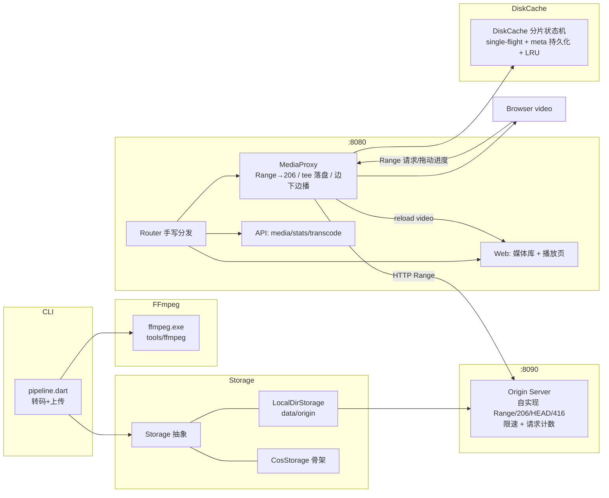

## 产品概述

一套本地可运行的视频点播管线：把本地视频文件转码成适合网络流式播放的 MP4，上传到"远端"存储，再由一个 HTTP 代理以磁盘缓存的方式转发给浏览器，实现打开即播、随意拖动进度条的边下边播体验。当前远端存储用本地目录模拟，接口预留可替换为真实 COS/CDN。

## 核心功能

- **本地转码**：选择本地视频文件，转成 moov 前置的 MP4（H.264 + AAC），输出期间显示进度百分比；同时提供合成示例视频能力，便于无素材时验证。
- **上传到远端存储**：转码产物按 key 上传；上传后端为可替换的存储抽象，当前落地"本地目录模拟远端"，真实 COS/CDN 以适配器形式预留。
- **播放代理（核心）**：浏览器播放器请求视频时，代理正确理解区间请求，返回"部分内容"响应，并在向浏览器下发数据的同时把数据写入本地磁盘缓存；已缓存的区间直接由磁盘返回，不再访问远端。
- **随意定位**：拖动进度条到任意位置都能立即开始播放，无需从头下载。
- **缓存管理**：磁盘缓存按分片管理，超容量时自动按最近使用时间淘汰；支持查看占用与手动清空。
- **媒体库与诊断**：列出远端可用视频、发起新的转码上传任务；提供可视化面板展示缓存分片覆盖位图、已下载字节、远端请求次数、当前播放位置与缓冲区间。
- **健壮性**：远端不支持区间请求时自动降级为自行裁剪；请求越界返回标准错误；播放器中途断开连接时，已开始的片段仍会继续落盘，提升后续命中率。

## 视觉呈现

浏览器端为深色玻璃拟态风格界面：深色背景配青紫渐变光晕，卡片带半透明模糊与细描边。媒体库为卡片网格，每张卡显示标题、时长、大小与状态；播放页为左播放器、右诊断面板的两栏布局，诊断面板以流光进度条与分片位图网格呈现缓存覆盖情况，播放/加载状态用呼吸光效表达。整体形态为桌面端 Web 界面，窗口自适应。

## 技术栈

- 语言/SDK：Dart 3.13.0（实测 `Dart SDK version: 3.13.0 (stable) on "windows_x64"`），纯 Dart 控制台应用，**不使用 Flutter 依赖**。
- 网络层：**`dart:io` 的 `HttpServer` + `HttpClient`**（不引入 shelf/shelf_router）。
- 决策理由：本任务的核心价值是**字节级精确的 HTTP 区间语义**（`Range` / `206` / `Content-Range` / `Content-Length` / `Accept-Ranges` / `bufferOutput=false` 真流式）。直接用 `dart:io` 可完全掌控响应头与流式写出，无中间层缓冲风险。
- 风险规避事实：本地 pub 缓存中仅有 `shelf_router-1.1.4`，其 `environment.sdk` 为 `'>=2.17.0 <3.0.0'`，与 Dart 3.13 不匹配，存在解析失败风险；且服务端路由需求很小（<10 条），手写分发器成本极低。
- 依赖（已确认存在于本地 pub 缓存，可离线解析）：
- 运行时：`args ^2.7.0`（CLI 参数）
- 开发：`lints ^6.0.0`、`test ^1.31.1`（`test_core-0.6.18`、`matcher-0.12.20`、`shelf_static-1.1.3`、`web_socket_channel-3.0.3`、`analyzer-13.0.0`、`coverage-1.15.1` 均在缓存中）
- 媒体处理：`tools/ffmpeg/ffmpeg.exe`（实测 `ffmpeg version 2022-10-30-git-ed5a438f05 ... --enable-libx264`，内置 `aac` 编码器与 `lavfi`/`testsrc`/`sine` 滤镜可用）。
- **重要事实**：`tools/ffmpeg/` 下**只有 `ffmpeg.exe`，没有 `ffprobe.exe`**，因此时长探测必须通过解析 `ffmpeg -i` 的 stderr（`Duration: hh:mm:ss.xx`）实现。
- 持久化：文件系统（`dart:io`），无需数据库。

## 实现方案

### 总体策略

单进程内同时运行两个 `HttpServer`：

1. **Origin Server（模拟 CDN，默认 `127.0.0.1:8090`）**：把 `data/origin/<key>` 暴露为真实 HTTP 端点，**自身正确实现 Range/206/HEAD/416**，并可选地做带宽限速与请求计数。它是"上游"，用于真实验证"206 透传"与"命中缓存后上游零请求"，而不是用本地文件读取作弊。
2. **App Server（代理 + 页面，默认 `127.0.0.1:8080`）**：`/media/<key>` 为核心代理；另有播放页、媒体库、统计与转码 API。

### 核心代理算法（边下边播的正确实现）

关键设计：**"先确保分片就绪并落盘，再从磁盘/内存消费"** 的分片状态机，而非"先整段下载再回给客户端"。

- 文件按固定 `chunkSize`（默认 1 MiB）切分为分片，`totalSize` 由缓存元数据或上游 `HEAD` 的 `Content-Length` 确定。
- `CacheEntry.ensureChunk(i)`：**单飞（single-flight）** —— 同一分片的并发请求合并为一个上游拉取；拉取时向上游发 `Range: bytes=<chunkStart>-<chunkEnd>`，把数据写入缓存文件的对应偏移，`flush` 后标记 ready，并把刚下载的 `Uint8List` 直接返回给**首个**消费者（零额外磁盘读）。
- `readRange(start, end)`：按分片顺序 `await ensureChunk(i)` → 立即 yield 该分片字节。首分片就绪即下发，**实现真正边下边播**；天然 tee（落盘发生在 ensure 阶段），且被其他并发客户端复用。
- 上游不支持 Range（返回 `200`）时，降级为顺序读取并在本地裁剪所需区间。
- 客户端中途断开：捕获 `SocketException`/`HttpException`，停止向其写数据，但已登记的分片可继续完成落盘（`--continue-after-disconnect`，默认开启），提升后续命中率。

### HTTP 语义覆盖清单（必须逐条实现并被测试固化）

| 场景 | 期望响应 |
| --- | --- |
| 无 `Range` | `200` + `Content-Length: total` + `Accept-Ranges: bytes` |
| `HEAD` | `200` + `Content-Length: total`，无响应体 |
| `bytes=0-` | `206` + `Content-Range: bytes 0-<total-1>/<total>`，`Content-Length = total` |
| `bytes=s-e` | `206` + `Content-Range: bytes s-e/<total>`，`Content-Length = e-s+1` |
| `bytes=-N`（后缀） | 解析为 `<total-N>-<total-1>`，按上一条返回 |
| 越界 `s >= total` | `416` + `Content-Range: bytes */<total>` |
| 多段 `bytes=0-9,20-29` | 忽略 Range，返回 `200` 全量（RFC 允许，最稳妥） |
| 非法 `Range` | 忽略 Range，返回 `200` 全量 |


其他要点：所有 200/206 响应带 `Accept-Ranges: bytes`、`Content-Type`（按扩展名，`.mp4` → `video/mp4`）、`ETag`（由 mtime+size 生成，透传）、`Last-Modified`；`HttpResponse.bufferOutput = false`，并 `await response.flush()` 及时推送响应头；若上游数据提前结束导致长度不足，立即关闭连接并记录 ERROR，避免 `Content-Length` 不匹配造成播放器卡死。

### 性能与可靠性

- **时间复杂度**：区间请求解析 O(1)；`readRange` 为 O(覆盖分片数)。命中缓存时零网络 I/O，仅磁盘顺序读（按 64 KiB 子块读取以控内存）。
- **瓶颈与缓解**：
- 上游带宽 / 磁盘随机读 → 分片并按需拉取；`--max-concurrent-upstream`（默认 4）信号量限流；可选 `--prefetch-ahead N` 顺序预取后续分片。
- 元数据写放大 → `readyChunks` 变更做节流持久化（每完成 N 片或每 500 ms 落一次 JSON，entry 释放/进程退出时强制 flush），不逐片写。
- 内存 → 仅保留 `Set<int> readyChunks`（1 MiB 分片下 4 GiB 文件约 4096 个整数，可忽略），不缓存整文件。
- 命中率 → 断开后继续落盘 + 分片粒度缓存 + LRU（按 `lastAccessAt`，`--max-cache-bytes` 默认 2 GiB，超限淘汰整个 entry 的 `.bin`+`.meta.json`）。
- **安全**：key 严格白名单校验（`[A-Za-z0-9._-]` 且拒绝 `..`、绝对路径、分隔符越权）防目录穿越；缓存分区目录对 key 做哈希前缀避免单目录文件过多；不记录任何凭据；API 仅监听回环地址（默认 `127.0.0.1`）。
- **可观测**：统一 `logger.dart`，级别 DEBUG/INFO/WARN/ERROR，`--verbose` 开 DEBUG；结构化记录 `key, range, cacheHit, upstreamReq, bytes, ms`；高频命中日志仅在 DEBUG 输出。

### ffmpeg 调用

- 定位顺序：`--ffmpeg` 参数 → 环境变量 `FFMPEG_PATH` → `<projectRoot>/tools/ffmpeg/ffmpeg.exe`（Windows，另兼容无扩展名）→ `PATH` 中的 `ffmpeg`；`projectRoot` 由脚本位置向上查找含 `pubspec.yaml` 的目录，并支持 `--project-root` 覆盖。找不到时抛出含"期望路径 + 提示"的明确异常，不静默失败。
- 转码参数：`-y -i <in> -c:v libx264 -preset veryfast -crf 23 -pix_fmt yuv420p -c:a aac -b:a 128k -ac 2 -movflags +faststart <out>`（`+faststart` 即把 moov 前置，是边下边播的前提）。
- 进度：`Process.start` + `-progress pipe:1 -nostats`，解析 `out_time_us` / `progress=end`，结合 `ffmpeg -i` 解析出的 `Duration` 计算百分比。
- 合成示例视频（无素材验证用）：`-f lavfi -i testsrc=duration=12:size=640x360:rate=30 -f lavfi -i sine=frequency=440:duration=12`。

### 存储抽象

```
abstract class Storage {
  Future<void> put(String key, Stream<List<int>> data, {int? length, String? contentType});
  Future<ObjectStat?> stat(String key);   // size / etag / contentType
  Future<void> delete(String key);
  Uri urlFor(String key);                 // 代理拉取用的上游 URL
}
```

- `LocalDirStorage`：写入 `data/origin/<key>`；`urlFor` 返回 `http://127.0.0.1:<originPort>/origin/<key>`。
- `CosStorage`：**可插拔适配器骨架** —— 通过注入的 `CosClient` 接口完成 put/stat/delete，`urlFor` 返回 CDN 域名 URL；默认实现为 `UnimplementedCosClient`，在缺少 `COS_SECRET_ID/COS_SECRET_KEY/COS_BUCKET/COS_REGION` 时构造即抛出带配置说明的异常（不做假签名、不伪造成功）。

## 架构设计



### 关键数据流

1. `pipeline.dart`：本地文件 → ffmpeg 转码 → `Storage.put(key)` → 文件落到 `data/origin/<key>`。
2. 浏览器打开媒体库 → 点播 → `video.src = /media/<key>`。
3. 播放器自动发 `Range` → `MediaProxy` 查 `ByteRange` → 查 `DiskCache` → 未命中则向 `OriginServer` 发带 Range 的请求 → 落盘 + 立即下发 → `206`。
4. 再次播放或拖动进度 → 命中 `readyChunks` → 磁盘直读，上游请求数不变。

## 目录结构

```
proxy_video/
├── pubspec.yaml                      # [NEW] 包定义：name=proxy_video, environment.sdk ^3.4.0；runtime: args；dev: lints, test
├── analysis_options.yaml             # [NEW] include: package:lints/recommended.yaml，开启强类型检查
├── .gitignore                        # [MODIFY] 保留 `tools`，追加 .dart_tool/、data/、build/、*.log（保留 pubspec.lock）
├── README.md                         # [NEW] 快速开始：pub get、生成示例视频、转码上传、启动服务、播放验证、Range 语义说明
├── tools/ffmpeg/ffmpeg.exe           # [已存在，被 gitignore]
├── bin/
│   ├── server.dart                   # [NEW] CLI 入口：解析参数→加载 Config→启动 OriginServer + AppServer→注册优雅关闭(SIGINT)与退出码
│   └── pipeline.dart                 # [NEW] CLI 入口：`--input` / `--demo` / `--key` / `--ffmpeg` / 转码进度 / 上传；失败返回非零退出码
├── lib/
│   ├── proxy_video.dart              # [NEW] 公共导出（Config/Storage/Transcoder/MediaProxy 等），便于测试引用
│   └── src/
│       ├── config.dart               # [NEW] 配置聚合：端口/监听地址、origin 地址、data/cache 目录、chunkSize、maxCacheBytes、并发上限、限速、prefetch、日志级别；支持环境变量默认值 + CLI 覆盖 + 启动校验
│       ├── logger.dart               # [NEW] 分级日志（DEBUG/INFO/WARN/ERROR），时间戳与结构化字段，避免 PII/二进制输出
│       ├── util/
│       │   ├── byte_range.dart       # [NEW] Range 头解析与 Content-Range 构造：单段/开放式/后缀式/越界(416)/多段降级/非法降级；parse(totalSize)
│       │   ├── semaphore.dart        # [NEW] 轻量并发信号量（无第三方依赖），用于上游并发限流
│       │   └── http_util.dart        # [NEW] 响应头写入工具、ETag 生成(mtime+size)、扩展名→Content-Type(.mp4/.m4v/.mov/.webm/.jpg…)、安全 key 校验(防目录穿越)
│       ├── media/
│       │   ├── ffmpeg_locator.dart   # [NEW] ffmpeg 路径解析（参数→env→tools/ffmpeg→PATH）与存在性校验，抛明确异常；projectRoot 向上查找 pubspec.yaml
│       │   ├── ffmpeg_probe.dart     # [NEW] 因无 ffprobe：解析 `ffmpeg -i` stderr 的 Duration，返回时长(ms)
│       │   └── transcoder.dart       # [NEW] 组装转码参数(movflags +faststart)、Process.start 运行、-progress pipe:1 进度解析、错误聚合与超时处理
│       ├── storage/
│       │   ├── storage.dart          # [NEW] Storage 抽象 + ObjectStat 数据类
│       │   ├── local_dir_storage.dart# [NEW] 落地 data/origin/<key>，put 支持 Stream 流式写入与长度校验，urlFor 指向 OriginServer
│       │   └── cos_storage.dart      # [NEW] COS 可插拔适配器骨架：CosClient 接口 + UnimplementedCosClient（缺配置时明确报错），urlFor 返回 CDN URL
│       ├── origin/
│       │   └── origin_server.dart    # [NEW] 模拟 CDN：GET/HEAD /origin/<key>，自实现 Range/206/HEAD/416，带宽限速(可选)、上游请求计数、404 语义；dart:io 实现
│       ├── cache/
│       │   ├── cache_entry.dart      # [NEW] 分片状态机：ready 集、单飞 ensureChunk、readRange(顺序 ensure+yield)、totalSize 解析(meta/HEAD)、节流 meta 持久化
│       │   └── disk_cache.dart       # [NEW] 缓存目录管理：哈希分区路径、meta.json 读写与恢复、LRU 淘汰、清空、统计；内存 entry 表
│       ├── proxy/
│       │   └── media_proxy.dart      # [NEW] 核心代理：GET/HEAD /media/<key>，Range→206/416/200，bufferOutput=false 真流式，tee 落盘，断开续传，错误映射(404/502)
│       ├── api/
│       │   └── api_routes.dart       # [NEW] /api/media(列表) /api/stats(缓存与上游计数) /api/transcode(POST 触发转码上传) /api/jobs/<id> /api/cache(清空)
│       ├── server/
│       │   ├── router.dart           # [NEW] 手写路由分发：方法+路径匹配、路径参数解析、统一错误处理与 404
│       │   └── app_server.dart       # [NEW] 组装路由、绑定监听、请求日志、优雅关闭
│       └── web/
│           └── play_page.dart        # [NEW] 内嵌 HTML/CSS/JS：媒体库卡片网格 + 播放页(播放器 + 分片位图诊断面板)，暗色玻璃拟态，轮询 /api/stats
├── test/
│   ├── byte_range_test.dart          # [NEW] 覆盖 0-/s-e/-N/越界/多段/非法/边界(total=0, s=e)
│   ├── disk_cache_test.dart          # [NEW] 临时目录下分片写入读取、meta 恢复、single-flight 去重、LRU 淘汰、并发读
│   ├── media_proxy_test.dart         # [NEW] 端到端：起真实 Origin+Proxy，断言 206/Content-Range/Content-Length/HEAD/416/200，二次请求上游计数不增，限速下首字节早于完整下载完成
│   └── helpers/test_origin.dart      # [NEW] 测试用 origin 与临时目录夹具
└── tool/
    └── e2e_smoke.dart                # [NEW] 无第三方依赖的端到端冒烟脚本：合成视频→转码→上传→起服务→发 Range 请求→打印断言结果（在 test 解析失败时的兜底验证路径）
```

## 关键代码结构

```
// lib/src/util/byte_range.dart —— Range 语义的唯一真相来源
enum RangeParseKind { none, satisfiable, unsatisfiable, ignore }

class ByteRange {
  final int start;   // inclusive
  final int end;     // inclusive
  int get length => end - start + 1;
  String contentRange(int total) => 'bytes $start-$end/$total';
}

class RangeParseResult {
  final RangeParseKind kind;
  final ByteRange? range;   // 仅 satisfiable 时非空
  // none: 无 Range → 200 全量
  // unsatisfiable: 416 + contentRangeUnsat(total) = 'bytes */total'
  // ignore: 非法/多段 → 忽略 Range，返回 200 全量
  static RangeParseResult parse(String? header, int totalSize);
}

// lib/src/cache/cache_entry.dart —— 边下边播与 tee 的契约
abstract class CacheEntry {
  int? get totalSize;
  Future<int> resolveTotalSize();                  // 优先 meta，其次上游 HEAD
  Future<Uint8List> ensureChunk(int index);        // single-flight；落盘后返回（首消费者零额外读）
  Stream<List<int>> readRange(int start, int end); // 顺序 ensureChunk + 立即 yield，实现边下边播
  Future<void> persistMeta();                      // 节流调用 + 强制 flush
}
```

## 设计方向

浏览器端为**深色玻璃拟态（Glassmorphism）+ 青紫渐变光晕**的桌面 Web 界面，直接由 Dart 服务内嵌 HTML/CSS/JS 输出，无前端构建步骤。

## 页面规划（2 个屏幕）

**屏幕一：媒体库 `/`**

- 顶部导航栏：左侧品牌标识（渐变文字），右侧"刷新"与"转码上传"主按钮；栏体半透明模糊、底部细描边。
- 转码上传面板：拖拽/输入本地路径 + 输出 key + 预设参数，提交后显示实时进度条（流光动画）与状态徽标。
- 媒体卡片网格：每张卡显示缩略占位（渐变底 + 播放图标）、文件名、key、大小、来源标记；悬停上浮并显示"播放"按钮，点击进入播放页。
- 底部状态栏：显示服务与远端存储连接状态、缓存总占用、当前并发数。

**屏幕二：播放页 `/play/<key>`**

- 顶部导航栏：返回媒体库、文件名与 key，右侧"清空该视频缓存"次按钮。
- 主播放器区：`<video>` 播放器居中，暗色卡片包裹，播放/缓冲状态用呼吸光效标识。
- 诊断面板（右侧栏）：分片位图网格（每格代表一个缓存分片，已缓存为青绿渐变、下载中为脉冲动画、未缓存为暗灰）；下方为已缓存字节/总字节进度条、远端请求次数、命中率、`currentTime`、`buffered` 区间文本。
- 快捷操作条：定位到 25%/50%/75%、重新加载、重置缓存三个按钮，用于直观验证"随意定位即时播放"。

## 交互与动效

- 卡片悬停：`translateY(-4px)` + 阴影加深 + 边框渐亮，160 ms 缓动。
- 位图分片：使用 CSS `transition` 让格子逐个点亮，形成"下载推进"的视觉反馈。
- 进度条：渐变背景 + 移动高光扫过动画，表达持续加载。
- 状态徽标：加载中脉冲、成功常亮、失败红色描边。
- 响应式：宽度 ≥1200 px 时播放页为左右两栏；<900 px 时诊断面板折到播放器下方并单列排布。

## 视觉基调

深色基底（近黑蓝）+ 青紫渐变主色，卡片使用 `backdrop-filter: blur()` 与 1px 半透明描边营造玻璃层次；整体强调"数据流在推进"的科技感，不使用纯白大面积或高饱和撞色。

## Agent Extensions

### Skill

- **dart-add-unit-test**
- Purpose: 为 `ByteRange` 解析、`DiskCache` 分片状态机、`MediaProxy` 区间响应等核心逻辑编写 `package:test` 单元与集成测试。
- Expected outcome: `test/` 下形成覆盖 Range 全边界（0-/s-e/-N/416/多段降级/HEAD）与缓存命中链路的可重复测试，`dart test` 全绿。
- **dart-run-static-analysis**
- Purpose: 对全项目执行 `dart analyze` 并自动修复机械性告警，保证交付代码零 error/warning。
- Expected outcome: 静态分析通过，`lints` 规则无违规残留。
- **dart-build-cli-app**
- Purpose: 规范 `bin/server.dart` 与 `bin/pipeline.dart` 两个 CLI 入口的参数解析、帮助输出、退出码与跨平台脚本约定。
- Expected outcome: 两个 CLI 具备 `--help`、明确退出码与清晰的错误信息。
- **dart-resolve-package-conflicts**
- Purpose: 当离线 `dart pub get` 因版本约束（尤其 `shelf_router-1.1.4` 的 `<3.0.0`）失败时，按流程收敛版本或改用最小依赖方案。
- Expected outcome: 依赖解析成功，或明确降级为"仅 dev 依赖 test/lints + 无依赖冒烟脚本"的可用状态。

### MCP

- **dart**
- Purpose: 使用 `pub` 执行依赖获取，使用 `analyze_files` 对修改路径做增量静态检查。
- Expected outcome: 依赖就绪、分析无错误，问题在编码阶段即时闭环。

### SubAgent

- **code-explorer**
- Purpose: 在实现阶段快速核对本地 pub 缓存中 `test`/`args` 的可用版本及其传递依赖（是否可完全离线解析），避免反复试错。
- Expected outcome: 明确可用的依赖版本组合，减少 `pub get` 往返。